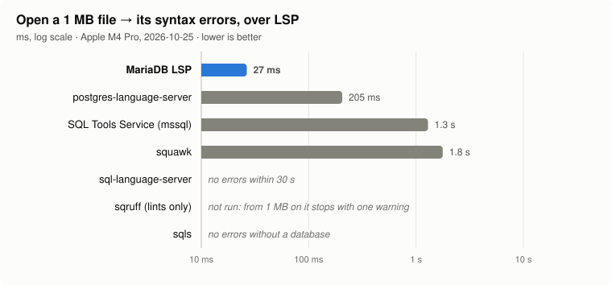
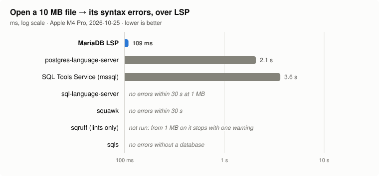
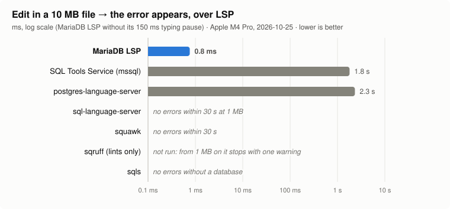
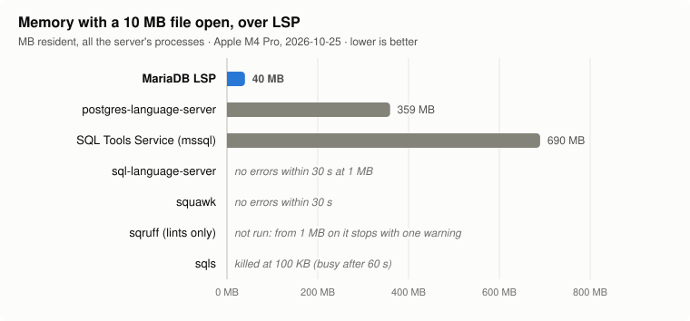
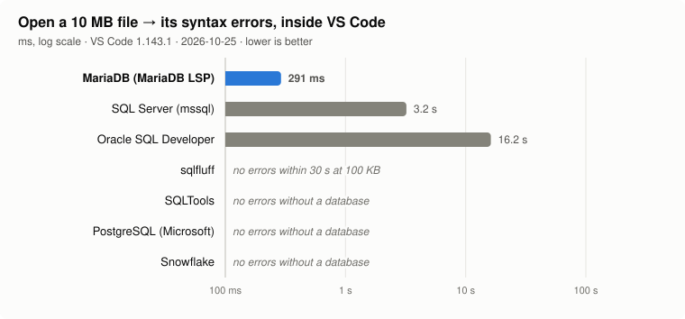
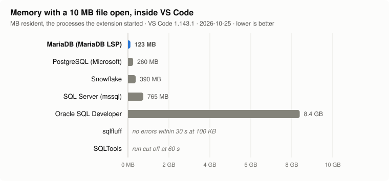

# Language server benchmarks

Measures MariaDB LSP against other SQL language servers on one generated SQL
script, without a database connection, two ways:

- **over LSP on stdio** (`run.py`): each server started on its own, driven by
  a small LSP client;
- **inside VS Code** (`vscode/run.js`): each extension alone in a VS Code it
  starts, timed through the VS Code API, for servers that only run inside
  their extension (Oracle SQL Developer) and to check the stdio numbers
  against the editor.

## Results

Apple M4 Pro, 14 cores, 64 GB, macOS 26.6, 2026-10-25
([stdio](results/2026-10-25-mac-mini.md), [VS Code](results/2026-10-25-mac-mini-vscode.json)).
Lower is better; times on a log scale.













The Markdown summary beside each results file holds every measure at every
size, with notes on what did not run and why. `charts.py` draws the charts
from a results file:

```bash
python3 benchmarks/charts.py benchmarks/results/2026-10-25-mac-mini
```

## The servers

Over LSP on stdio (`servers.py` pins the versions and says how each server is
started and configured):

| Server | Version | Dialect | Notes |
| --- | --- | --- | --- |
| MariaDB LSP | this checkout | MariaDB | `$MARIADB_LSP`, else `build/bin/mariadb-lsp`; use a Release build |
| [SQL Tools Service](https://github.com/microsoft/sqltoolsservice) | 6.0.20261023.1 | T-SQL | the server behind VS Code's mssql extension (.NET) |
| [postgres-language-server](https://github.com/supabase-community/postgres-language-server) | 0.28.2 | PostgreSQL | Rust, Supabase; `lsp-proxy` in front of a daemon; completion needs a database |
| [squawk](https://github.com/sbdchd/squawk) | 2.70.0 | PostgreSQL | Rust linter for Postgres migrations (`squawk server`); pull diagnostics |
| [sql-language-server](https://github.com/joe-re/sql-language-server) | 1.7.1 | MySQL | Node.js |
| [sqls](https://github.com/sqls-server/sqls) | 0.2.48 | MySQL, PostgreSQL, … | Go; reports no diagnostics without a database; run up to 100 KB |
| [sqruff](https://github.com/quarylabs/sqruff) | 0.43.0 | ANSI here | Rust SQL linter (`sqruff lsp`); reports lints but no syntax errors; run up to 100 KB |

Inside VS Code 1.143.1 (`vscode/run.js` pins the versions):

| Extension | Version | Notes |
| --- | --- | --- |
| MariaDB Shell for VS Code | 26.10.1 | from its `.vsix` (`$MARIADB_VSIX`, else `../vscode-extension/`), with this checkout's MariaDB LSP |
| Oracle SQL Developer for VS Code | 26.3.0 | its Java backend is not a server one can start on its own |
| SQL Server (mssql) | 1.47.0 | SQL Tools Service in the editor |
| sqlfluff | 4.0.2 | runs the `sqlfluff` command (4.4.0) on each change |
| SQLTools | 0.28.6 | no syntax errors without a database: completion and formatting only |
| PostgreSQL (Microsoft) | 1.33.0 | no syntax errors without a database: completion and formatting only |
| Snowflake | 1.42.3 | no syntax errors without a database: completion and formatting only |

## Install

```bash
python3 benchmarks/install.py            # all of them, or name some
cd benchmarks/vscode && npm install      # for the VS Code runs
```

`install.py` downloads the releases for this platform into
`benchmarks/.servers/`, which git ignores; it needs curl, tar, unzip, npm (for
sql-language-server) and Python (sqlfluff goes into an environment of its
own). The VS Code runs download VS Code and the extensions into
`benchmarks/.vscode-test/`, also ignored.

MariaDB LSP is built from this checkout, in Release mode:

```bash
cmake -S . -B build-release -G Ninja -DCMAKE_BUILD_TYPE=Release -DWITH_TESTS=0 …
cmake --build build-release --target mariadb-lsp
```

## Run

```bash
export MARIADB_LSP=$PWD/build-release/bin/mariadb-lsp
python3 benchmarks/run.py                                   # every server, every size
python3 benchmarks/run.py --servers mariadb-lsp,squawk --sizes 10K,1M --append
node benchmarks/vscode/run.js                               # every extension
node benchmarks/vscode/run.js --extensions mariadb,oracle --append
python3 benchmarks/charts.py benchmarks/results/<date>-<host>
```

Both write `benchmarks/results/<date>-<host>.json` (the VS Code runs
`…-vscode.json`; `--out` picks another name, `--append` replaces only the
servers named). Follow a run with `tail -f benchmarks/.runs/latest.log`: both
log every step there, with the time.

Every wait (for diagnostics, completion, formatting) gives up after 30 s, and
every server process or VS Code run is ended after 60 s: an LSP server answers
in far less. A server that reports nothing in time gets "none" and is skipped at
the larger sizes; what it measured before is kept.

## What is measured

The script (`workload.py`) is plain SQL that MariaDB, MySQL, SQL Server and
PostgreSQL all accept:

- blocks of CREATE TABLE, single-row INSERTs, a multi-line SELECT with JOIN
  and GROUP BY, an UPDATE and a DELETE, repeated to 10 KB, 100 KB, 1 MB and
  10 MB;
- one syntax error (`SELEC`) on the last line, so a server reports it only
  after parsing the whole file.

Per server and size, each run in fresh processes and a workspace of its own:

| Measure | From → to |
| --- | --- |
| Startup | spawn → the initialize reply (median of `--repeat` runs); in VS Code the cold start, opening a first file → its errors |
| Open | didOpen → the first diagnostics holding the last line's error (median of `--repeat` runs); in VS Code an error near it, since an extension may put it on the statement before |
| Edit | a SELECT in the middle broken (`SELECT` → `SELEC`) and fixed, `--edit-rounds` times (half at 10 MB): didChange → the diagnostics that show, and that drop, its error |
| Completion | after the FROM and WHERE keywords of SELECTs spread over the file: latency and item count, after one completion and a 2 s pause (the file open a moment, as when typing; an editor asks for the outline on open, and MariaDB LSP builds the outline of a file of 4 MB or more in the background) |
| Formatting | the whole document, at `--format-sizes` (1 MB): latency and edit count |
| Memory | resident set size of all the server's processes, after the open and at the end; in VS Code of every process the extension host started |

Only errors count as the error appearing: a linter's warnings on the same line
do not. MariaDB LSP runs with `debounceMs: 0`, so edits measure the check alone;
as shipped it first waits 150 ms for typing to pause. In VS Code about 50 ms of
each edit is VS Code's own handling of diagnostics.

Each VS Code extension keeps a profile of its own (`.vscode-test/profile-<name>`):
its first start there, which shows its welcome pages, is not measured, so the
cold start is that of an extension that has started before.

## Limits

- One workload, and no database connection: servers that do more when
  connected (SQL Tools Service's completion and formatting, sqls,
  postgres-language-server's completion and type checks, SQLTools, the
  PostgreSQL and Snowflake extensions) are measured offline.
- sqls and sqruff run up to 100 KB (`max_size` in `servers.py`, with the reason).
- One machine per results file; compare results from the same machine.
